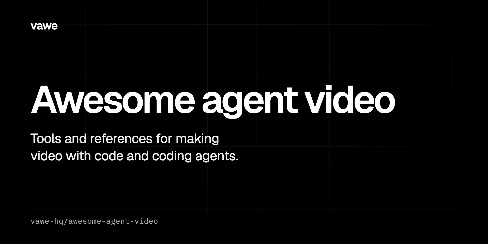

  

  
  
  

<b>HTML-to-video frameworks, animation libraries, agent skills and guides.</b>

  <a href="https://vawe.dev">vawe.dev</a> |
  <a href="https://vawe.dev/docs">Docs</a> |
  <a href="https://github.com/vawe-hq/skills">Skills</a>

# Awesome Agent Video 

> Tools and references for making video with code and with coding agents.

This list covers HTML-to-video and programmatic video frameworks, hosted video APIs, animation libraries that run in a web page, agent skills for video, and guides. Each entry has one line with a fact checked on the tool's own page. The [vawe-hq](https://github.com/vawe-hq) team keeps it, and vawe is one entry among the others. Entries are in alphabetical order inside each section. Checked on 2026-10-30.

## Contents

- [Frameworks](#frameworks)
- [Hosted video APIs](#hosted-video-apis)
- [Animation libraries](#animation-libraries)
- [Agent skills](#agent-skills)
- [Guides](#guides)
- [Related lists](#related-lists)
- [Contributing](#contributing)

## Frameworks

Code in, video file out.

- [Editly](https://github.com/mifi/editly) - Node.js and ffmpeg tool whose edits are a JSON or JSON5 spec, a command line or a JavaScript API; MIT.
- [HyperFrames](https://github.com/heygen-com/hyperframes) - Each video is a plain HTML file with data attributes for start time, duration and track, and animation runs on a paused timeline such as GSAP; Apache 2.0.
- [Manim](https://github.com/3b1b/manim) - Python animation engine for explanatory math videos; MIT.
- [Motion Canvas](https://github.com/motion-canvas/motion-canvas) - TypeScript toolkit where animations are generator functions, with a real-time editor; its [rendering docs](https://motioncanvas.io/docs/rendering) describe saving each frame as an image that you assemble with a tool such as ffmpeg; MIT.
- [Remotion](https://github.com/remotion-dev/remotion) - Makes videos with React components; its license requires a company license in some cases, so read it before commercial use.
- [Revideo](https://github.com/redotvideo/revideo) - Renders TypeScript scenes to video files and says it borrows concepts from Remotion and Rive; MIT.
- [vawe](https://github.com/vawe-hq/vawe) - A film is one `page.html` driven by CSS keyframes, Web Animations or a `window.seek(t)` function, and the renderer replaces the clock and randomness before it seeks Chrome to each frame; Apache 2.0.

## Hosted video APIs

Send a request, get a file back. Rendering runs on the vendor's servers.

- [JSON2Video](https://www.json2video.com) - Videos are described in a JSON schema and sent to a REST API, and its FAQ says renders run on its cloud infrastructure.
- [Shotstack](https://www.shotstack.io) - A cloud video editing API with a white-label editor you can embed in your own app.

## Animation libraries

Libraries that run in a web page.

- [Anime.js](https://github.com/juliangarnier/anime) - A JavaScript animation engine; MIT.
- [GSAP](https://github.com/greensock/GSAP) - Zero-dependency JavaScript library that animates CSS, SVG, canvas and arbitrary object properties, free for commercial use under [its standard license](https://gsap.com/standard-license).
- [lottie-web](https://github.com/airbnb/lottie-web) - Plays After Effects animations in the browser with an SVG, canvas or HTML renderer; MIT.
- [Motion](https://github.com/motiondivision/motion) - Formerly Framer Motion, an animation library for React and JavaScript with Vue support; MIT.
- [Theatre.js](https://github.com/theatre-js/theatre) - Motion design toolkit for the web; the core is Apache 2.0 and the studio editor is AGPL 3.0.
- [three.js](https://github.com/mrdoob/three.js) - JavaScript 3D library; the current builds include WebGL and WebGPU renderers, with SVG and CSS3D renderers as addons; MIT.

## Agent skills

Skills (`SKILL.md` folders) that teach a coding agent a video tool.

- [HyperFrames community skills](https://github.com/heygen-com/hyperframes-community-skills) - Eight independent skills for HyperFrames, installed with `npx skills add heygen-com/hyperframes-community-skills --skill <skill-name>`; Apache 2.0.
- [Remotion skills](https://github.com/remotion-dev/skills) - Twelve skills for Remotion projects, installed with `npx skills add remotion-dev/skills`.
- [vawe skills](https://github.com/vawe-hq/skills) - Six skills for vawe (html-to-video, vawe-brief, vawe-critique, vawe-page, vawe-reference, vawe-transitions), installed with `npx skills add vawe-hq/skills`; Apache 2.0.

## Guides

- [HyperFrames determinism](https://hyperframes.heygen.com/concepts/determinism) - States that a composition yields identical video on every render because each frame is computed from its frame number, not real time.
- [HyperFrames vs Remotion](https://hyperframes.heygen.com/guides/hyperframes-vs-remotion) - Compares two tools that render web pages to video frame by frame, and says "Remotion asks for a React component. HyperFrames asks for an HTML file."
- [Remotion Agent Skills](https://www.remotion.dev/docs/ai/skills) - Names Claude Code, Codex, Kimi Code and Cursor as compatible agents and lists three ways to install the skills.

## Related lists

- [awesome-claude-video-skills](https://github.com/zhuyansen/awesome-claude-video-skills) - A list of video skills and toolkits for coding agents, built by a model that reads READMEs, with a README quality bar for repos under 50 stars.

## Contributing

Read [CONTRIBUTING.md](CONTRIBUTING.md). One entry per pull request, with a fact from the tool's own page.

## Maintained by vawe-hq

Kept by the team behind [vawe](https://vawe.dev), an open-source HTML-to-video framework for coding agents. License: [CC0 1.0](LICENSE).
